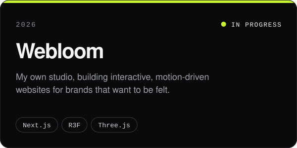
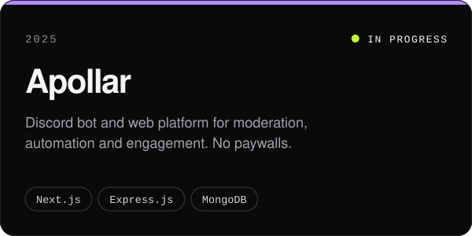
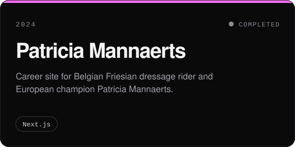
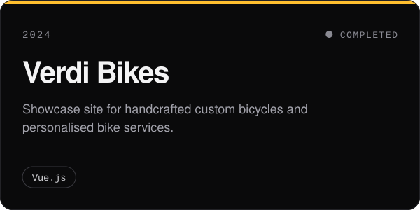
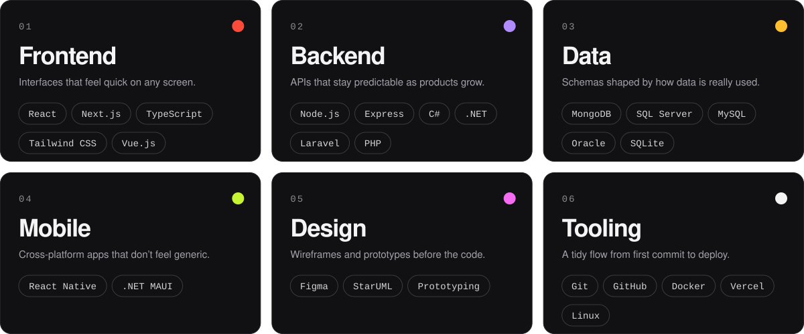
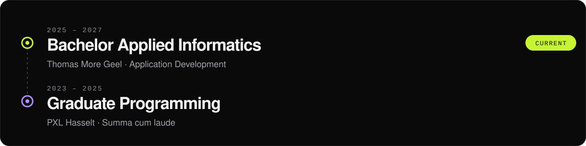

 

### Hi, I'm Jesse 👋

I build software that feels considered: quick to load, clear to use and careful in the details.

I'm a 21-year-old application developer from Limburg, Belgium. After graduating **summa cum laude** in Programming at PXL Hasselt, I moved on to Application Development at **Thomas More Geel** (graduating 2027). Alongside my studies I build websites and platforms for clients, from a Discord bot platform to the site of a European dressage champion.

**Currently open to internships and freelance work.**

  
  
  
  

 

<table>
  <tr>
    <td width="50%"></td>
    <td width="50%"></td>
  </tr>
  <tr>
    <td width="50%"></td>
    <td width="50%"></td>
  </tr>
</table>

<a href="https://jessev.be/projects"><b>All 8 projects on jessev.be</b></a>

  

  

  
  

  

